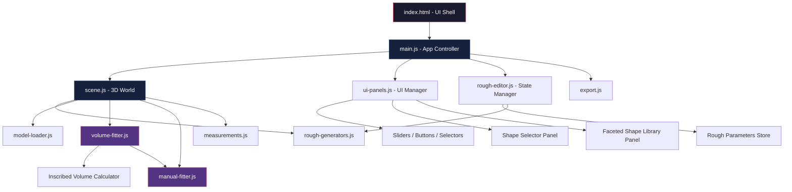
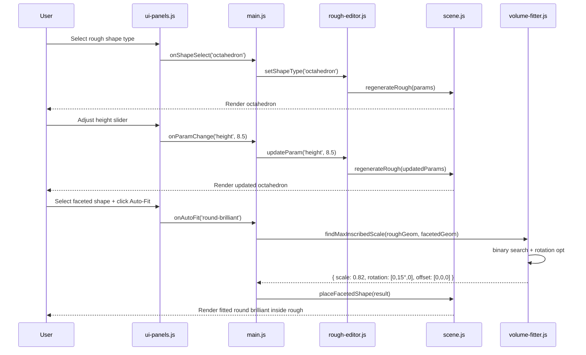

# WebGL Diamond CAD — Architecture & Implementation Plan

## Overview

A pure client-side WebGL application using **Three.js** for 3D visualization and editing of rough diamond shapes, with volume-based fitting of faceted diamond models. Inspired by Sarine/Octonus diamond planning systems.

---

## Technology Stack

| Layer | Choice | Rationale |
|-------|--------|-----------|
| 3D Engine | **Three.js r160+** (CDN) | Mature WebGL library, excellent .glb/.obj support, orbit controls built-in |
| UI | Vanilla HTML/CSS/JS | No build toolchain needed; fast iteration |
| Module Pattern | ES Modules (importmap or direct CDN) | Clean separation without bundler |
| Math | Three.js built-in + custom computational geometry | Vector3, Matrix4, Box3, Raycaster all provided |
| File Loading | `THREE.GLTFLoader` + `THREE.OBJLoader` | For user-provided faceted models |

---

## Project Structure

```
/ (root)
├── index.html              # Main entry point, UI shell
├── css/
│   └── style.css           # All styles, layout, panel design
├── js/
│   ├── main.js             # App initialization, event wiring, state management
│   ├── scene.js            # Three.js scene setup (renderer, camera, lights, grid, controls)
│   ├── rough-generators.js # Procedural geometry for 4 rough shapes
│   ├── rough-editor.js     # Resizing logic, parameter management per shape
│   ├── model-loader.js     # .glb/.obj loading for faceted shapes
│   ├── volume-fitter.js    # Automatic inscribed-shape fitting algorithm
│   ├── manual-fitter.js    # Drag/rotate faceted shape inside rough with clipping detection
│   ├── measurements.js     # Proportion calculations, display overlays
│   ├── export.js           # Screenshot, JSON report, optional 3D export
│   └── ui-panels.js        # DOM panel management, sliders, buttons, event binding
├── models/                 # User-provided faceted diamond .glb/.obj files
│   ├── round-brilliant.glb
│   ├── princess.glb
│   ├── emerald.glb
│   ├── cushion.glb
│   ├── oval.glb
│   ├── pear.glb
│   ├── marquise.glb
│   ├── heart.glb
│   ├── radiant.glb
│   └── asscher.glb
└── plans/
    └── plan.md             # This document
```

---

## Architecture Diagram



---

## Component Specifications

### 1. `scene.js` — 3D Rendering Core

**Responsibilities:**
- Initialize `THREE.WebGLRenderer` with antialiasing, transparency
- Set up perspective camera (default: 45° FOV, positioned at 10 units)
- Configure lighting: 1 ambient + 2 directional (key + fill) + optional hemisphere
- Add `THREE.OrbitControls` for free rotation/zoom/pan
- Render ground grid and optional axis helper
- Maintain scene object groups: `roughGroup`, `facetedGroup`, `helperGroup`
- Animation loop via `requestAnimationFrame`
- Handle window resize

**Key Config:**
```javascript
renderer.setClearColor(0x1a1a2e); // dark background
renderer.shadowMap.enabled = true;
renderer.toneMapping = THREE.ACESFilmicToneMapping;
```

### 2. `rough-generators.js` — Procedural Rough Shapes

Each generator returns a `THREE.BufferGeometry` with parameterized dimensions.

#### Octahedron
- Two square pyramids joined at base
- Parameters: `height` (total), `width` (girdle diameter), `girdleThickness` (0-20% of height)
- Construction: custom vertex math — 8 triangular faces forming upper/lower pyramids
- Optional: truncation at top/bottom for table/culet flats

#### Dodecahedron (Rhombic)
- 12 rhombic faces, diamond-specific proportions
- Parameters: `height`, `width`, `aspectRatio` (height/width)
- Construction: mathematically defined vertices for a rhombic dodecahedron, scaled independently on X/Y/Z

#### Macle (Twinned / Contact Twin)
- Two octahedral halves joined along a twin plane with angular offset
- Parameters: `halfHeight`, `halfWidth`, `twistAngle` (rotation of one half relative to the other)
- Construction: generate two half-octahedra, apply rotation transform to one, merge

#### Makeable (Irregular / Custom Polyhedron)
- Generalized convex polyhedron defined by vertex set
- Parameters: `profilePoints` (array of 2D profile vertices revolved or extruded), `height`
- Construction: lathe/extrude a user-defined profile, or load from predefined vertex set
- This is the most flexible shape — can represent any "makeable" rough

### 3. `rough-editor.js` — Resizing & Parameter Management

**State per rough shape:**
```javascript
{
  type: 'octahedron' | 'dodecahedron' | 'macle' | 'makeable',
  params: {
    height: number,      // mm or relative units
    width: number,
    aspectRatio: number, // computed or direct
    // shape-specific extras
    girdleThickness: number,  // octahedron only
    twistAngle: number,       // macle only
  },
  lockedParams: ['aspectRatio'], // which params stay proportional
}
```

**Resizing mechanics:**
- Sliders in UI panel bound to each parameter
- "Lock aspect ratio" toggle — when on, changing height auto-adjusts width
- Real-time geometry regeneration on slider change (debounced at ~30fps)
- Numeric input fields alongside sliders for precision entry
- Preset buttons: "1:1", "1:1.2", "1:1.5" common diamond proportions

### 4. `model-loader.js` — Faceted Shape Loading

**Responsibilities:**
- Load `.glb` files via `THREE.GLTFLoader` (preferred — compact, supports materials)
- Load `.obj` files via `THREE.OBJLoader` (fallback)
- Maintain a catalog/dictionary of loaded faceted shapes
- Compute bounding box and convex hull for each loaded model (needed for fitting)
- Apply diamond-like material: high refractive index look (MeshPhysicalMaterial with transmission/ior)
- Scale normalization: all loaded models normalized to a reference size for comparison

**Loading flow:**
1. User drops files or selects from pre-loaded `/models/` directory
2. Model loaded, centered at origin, bounding box computed
3. Added to faceted shape library panel as thumbnail + name
4. Ready for fitting operations

### 5. `volume-fitter.js` — Automatic Inscribed Shape Fitting ⭐

This is the core algorithmic component — finding the largest scaled version of a faceted shape that fits entirely inside the rough diamond volume.

**Algorithm: Binary Search + Containment Testing**

```
function findMaxInscribedScale(roughGeometry, facetedGeometry, options):
  // 1. Precompute rough convex hull (if not already convex)
  // 2. Sample faceted shape vertices (or use bounding convex hull)
  // 3. Binary search on scale factor (0.1 to 2.0):
  //    - Scale faceted vertices
  //    - For each vertex, test if it lies inside rough convex hull
  //    - Also test with rotation optimization (try N orientations)
  // 4. Return optimal { scale, rotation, offset }
```

**Containment test:** Point-in-convex-polyhedron using half-space tests (each face plane of rough hull — point must be on the "inside" side of all planes).

**Rotation optimization:** For each scale candidate, try a set of rotations (e.g., 36 steps around Y axis, ±15° tilt on X/Z) to find the orientation that allows the largest scale. This is critical because diamond faceted shapes have orientation-dependent fit (e.g., elongated shapes like pear/marquise).

**Performance considerations:**
- Precompute rough hull face planes once (not per test)
- Use vertex sampling for faceted shapes (every Nth vertex) for speed
- Run coarse search first (10 steps), then refine around best result (10 more steps)
- Web Worker candidate for heavy computation (non-blocking UI)

### 6. `manual-fitter.js` — Interactive Manual Positioning

**Responsibilities:**
- Allow user to drag/rotate/scale a selected faceted shape within the rough
- Real-time clipping visualization: color vertices/lines that fall outside rough volume in RED
- Provide `THREE.TransformControls` for translate/rotate/scale gizmos
- Snap-to-fit button: runs auto-fitter from current manual position as starting point
- Show fill percentage: what % of rough volume is utilized by current faceted placement

**Visual feedback:**
- Faceted shape rendered semi-transparent when inside rough
- Portions outside rough highlighted in red wireframe
- Rough rendered as transparent/wireframe during manual mode
- Real-time volume utilization % displayed in overlay

### 7. `measurements.js` — Proportions & Analytics

**Calculations:**
- Rough volume (from convex hull or mesh volume integration)
- Faceted shape volume
- Volume utilization % = faceted_volume / rough_volume * 100
- Maximum dimensions (length, width, depth) of both rough and faceted
- Girdle plane area
- Weight estimation (carats) based on volume × diamond density (3.51 g/cm³)

**Display:**
- Overlay panel with key measurements
- Dimension lines in 3D view (optional, toggleable)
- Color-coded utilization bar (green >60%, yellow 40-60%, red <40%)

### 8. `export.js` — Output Generation

**Export options:**
1. **Screenshot**: `renderer.domElement.toDataURL()` → download as PNG
2. **JSON Report**: all measurements, parameters, fitting results → downloadable `.json`
3. **GLB Export** (optional/stretch): export the combined scene (rough + placed faceted) using `THREE.GLTFExporter`
4. **Print-friendly view**: CSS-styled summary page for printing

### 9. `ui-panels.js` — UI Management

**Panel layout (left sidebar + right properties):**

```
┌──────────────────────────────────────────────────────┐
│  Toolbar: [Octahedron] [Dodecahedron] [Macle] [Mkbl] │
├──────────────┬───────────────────┬───────────────────┤
│  Rough       │                   │  Properties       │
│  Shapes      │   3D VIEWPORT     │  ─────────────    │
│  ───────     │                   │  Height: [===]    │
│  • Octa      │                   │  Width:  [===]    │
│  • Dodeca    │                   │  Aspect: [lock]   │
│  • Macle     │                   │  Girdle: [===]    │
│  • Makeable  │                   │                   │
│              │                   │  Faceted Shape:   │
│  Faceted     │                   │  [Dropdown ▼]    │
│  Library     │                   │  Auto-Fit [Btn]   │
│  ───────     │                   │  Manual  [Btn]    │
│  • Round     │                   │                   │
│  • Princess  │                   │  Measurements:    │
│  • Emerald   │                   │  Vol: 0.85 ct     │
│  • Cushion   │                   │  Util: 62% ████   │
│  • Oval      │                   │                   │
│  • Pear      │                   │  [Export ▼]      │
│  • Marquise  │                   │                   │
│  • Heart     │                   │                   │
│  • Radiant   │                   │                   │
│  • Asscher   │                   │                   │
├──────────────┴───────────────────┴───────────────────┤
│  Status bar: Ready │ Rough: Octahedron │ Scale: 1.0  │
└──────────────────────────────────────────────────────┘
```

**UI Components:**
- Range sliders with numeric input (custom element or native `input[type=range]` + `input[type=number]` synced)
- Toggle switches for wireframe mode, transparency, dimension lines
- Color pickers for rough material, faceted material
- Dropdown for faceted shape selection
- Buttons: Auto-Fit, Manual Mode, Reset, Export
- File drop zone for loading custom faceted models

---

## Data Flow



---

## Implementation Order (Build Phases)

### Phase 1: Foundation
1. Set up `index.html` with Three.js CDN import map
2. Create `css/style.css` with the panel layout
3. Implement `scene.js` — renderer, camera, lights, orbit controls, grid
4. Verify: rotating empty 3D scene with grid

### Phase 2: Rough Shapes
5. Implement `rough-generators.js` — octahedron first (simplest)
6. Implement `rough-editor.js` — parameter state management
7. Implement `ui-panels.js` — shape selector + sliders
8. Wire up: select octahedron → render → resize via sliders
9. Add dodecahedron generator
10. Add macle generator
11. Add makeable generator

### Phase 3: Faceted Shapes
12. Implement `model-loader.js` — GLB/OBJ loading
13. Create faceted shape library UI panel
14. Pre-load standard set from `/models/` directory
15. Implement drag-and-drop for custom models

### Phase 4: Fitting Algorithms
16. Implement convex hull computation utilities
17. Implement point-in-convex-polyhedron test
18. Implement `volume-fitter.js` — binary search auto-fit
19. Implement `manual-fitter.js` — TransformControls + clipping viz
20. Wire auto-fit and manual modes to UI

### Phase 5: Measurements & Export
21. Implement `measurements.js` — volume, utilization, carat estimation
22. Add measurement overlay panel
23. Implement `export.js` — screenshot + JSON report
24. Add export buttons to UI

### Phase 6: Polish
25. Material/color controls for rough and faceted shapes
26. Wireframe toggle
27. Dimension lines in 3D view
28. Responsive layout adjustments
29. Performance optimization (debouncing, LOD)

---

## Key Technical Challenges & Mitigations

| Challenge | Mitigation |
|-----------|------------|
| **Volume fitting accuracy** | Use convex hulls for both rough and faceted; binary search with 20+ steps; rotation sampling at 10° increments |
| **Non-convex rough shapes** | Macle and makeable may be non-convex; decompose into convex sub-volumes or use signed distance field approach |
| **Performance during slider drag** | Debounce geometry regeneration to 30fps; use `BufferGeometry` directly (no CSG); limit vertex count |
| **.glb material preservation** | Three.js GLTFLoader preserves PBR materials; enhance with `MeshPhysicalMaterial` for diamond look |
| **Clipping visualization** | Use vertex shader to color out-of-bounds vertices red; or compute per-vertex and update vertex colors buffer |
| **Mobile responsiveness** | Collapse side panels into drawers on small screens; touch-enabled orbit controls |

---

## API / Interface Contracts

### `rough-generators.js` exports:
```javascript
function generateOctahedron({ height, width, girdleThickness }) → THREE.BufferGeometry
function generateDodecahedron({ height, width, aspectRatio }) → THREE.BufferGeometry
function generateMacle({ halfHeight, halfWidth, twistAngle }) → THREE.BufferGeometry
function generateMakeable({ profilePoints, height }) → THREE.BufferGeometry
function computeConvexHull(geometry) → { vertices: Vector3[], faces: Plane[] }
```

### `volume-fitter.js` exports:
```javascript
function findMaxInscribedScale(roughHull, facetedGeometry, options) → FittingResult
// FittingResult: { scale: number, rotation: Euler, offset: Vector3, utilization: number }
function testContainment(roughHull, facetedVertices) → boolean
```

### `model-loader.js` exports:
```javascript
function loadFacetedModel(url) → Promise<THREE.Object3D>
function getModelBoundingInfo(object) → { box: Box3, convexHull: Hull, volume: number }
function getLoadedModels() → Map<string, ModelEntry>
```

---

## Next Steps After Plan Approval

1. User provides the ~10 faceted diamond `.glb` files → place in `/models/`
2. Switch to **Code mode** to begin Phase 1 implementation
3. Iterative build: each phase produces a testable increment